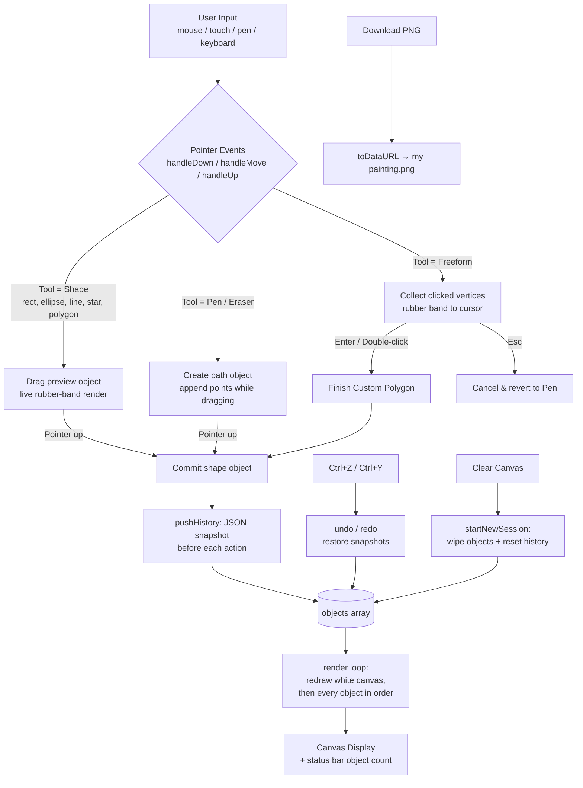

# 🎨 Painter Studio — Web Paint Program

> A zero-dependency, browser-based paint program built with plain HTML, CSS, and JavaScript (Canvas 2D). Part of the [Connor Lonergan Portfolio](https://zencode22.github.io) — open the app at [`painter.html`](./painter.html).

---

## 📖 Overview

**Painter Studio** is a lightweight web painting application that runs entirely in the browser. Everything you draw is stored as a list of vector-like **objects** that are re-rendered on every frame, which powers features like unlimited undo/redo, live shape previews, and clean PNG exports.

No frameworks, no build step, no server required — just open the page and start drawing. Works with mouse, touch, and stylus input via Pointer Events.

---

## ✨ Features

### Drawing Tools
| Tool | Description |
|------|-------------|
| ✏️ **Pen** | Freehand strokes with adjustable size and color |
| 🧽 **Eraser** | Paint away strokes with the background color |
| ▭ **Rectangle** | Drag to draw; hold **Shift** to constrain to a square |
| ◯ **Ellipse** | Drag to draw; hold **Shift** to constrain to a circle |
| ╱ **Line** | Straight line from drag start to end |
| ★ **Star** | Five-point star scaled by your drag |

### Custom Shapes
- **Regular polygons** via dropdown: ▲ Triangle, ⬟ Pentagon, ⬡ Hexagon, ⬠ Heptagon, 🛑 Octagon
- **✏️ Draw Custom Shape (Freeform mode):** click point-by-point to build your own polygon. A rubber-band preview follows your cursor. Finish with **double-click** or **Enter**; cancel with **Esc**.

### Styling
- **Shape Style:** Fill, Stroke, Fill + Stroke, or No Fill (outline only)
- **Fill Color:** quick swatches (Black / Palestine Red / Palestine Green / White) plus a full custom color picker
- **Stroke Color:** dedicated outline color picker
- **Brush Size:** slider from 1–60 px

### History & Sessions
- ↩️ **Undo / ↪️ Redo** with snapshot-based history (unlimited depth per session)
- Keyboard shortcuts: `Ctrl/Cmd+Z` (undo), `Ctrl/Cmd+Y` or `Ctrl/Cmd+Shift+Z` (redo), `Enter` (finish freeform), `Esc` (cancel freeform)
- 🗑️ **Clear Canvas** starts a brand-new session: wipes the board *and* resets all history (with confirmation)

### Export
- ⬇️ **Download Painting (PNG)** — renders a clean frame (no in-progress previews) and saves it as `my-painting.png`

### UX Extras
- Status bar showing live object count and contextual hints
- Responsive toolbar layout for small screens
- Touch-friendly (`touch-action: none`, double-tap zoom suppressed)
- Pointer capture keeps strokes reliable even if the cursor briefly leaves the canvas

---

## 🧭 Architecture Flowchart

---

## 🗂 How It Works (Internals)

1. **Object model** — Every stroke or shape is an object (`type`, points/bounds, colors, size, style) pushed into an `objects` array. The canvas is fully redrawn from this list on each change, so the picture is always reproducible.
2. **Geometry helpers** — `objPoints()` / `objBBox()` compute bounding geometry for both recorded paths and parametric shapes (stars, ellipses, polygons generate outline points mathematically).
3. **Styling** — `applyStyle()` maps the Fill Color picker to fills and the Stroke Color picker to outlines according to the selected Shape Style.
4. **History** — Before each committed action, the object list is serialized (`JSON.stringify`) onto an undo stack; undone states move to a redo stack. Clearing the canvas resets both stacks.
5. **Input** — Modern browsers use unified **Pointer Events** with `setPointerCapture`; older browsers fall back to mouse/touch listeners.

---

## 🚀 Getting Started

1. Clone or download this repository.
2. Open `painter.html` in any modern browser (or serve the folder, e.g. `python3 -m http.server`).
3. Draw! Your painting can be exported with the **Download Painting (PNG)** button.

On the live site, reach the painter via the **“🎨 Try my Web Painter →”** link on the portfolio home page ([index.html](./index.html)).

---

## ⌨️ Keyboard Shortcuts

| Shortcut | Action |
|----------|--------|
| `Ctrl/Cmd + Z` | Undo |
| `Ctrl/Cmd + Y` / `Ctrl/Cmd + Shift + Z` | Redo |
| `Enter` | Finish freeform custom shape |
| `Esc` | Cancel freeform (returns to Pen) |
| `Shift` (while dragging) | Constrain rectangle to square / ellipse to circle |

---

## 🧱 Tech Stack

- **HTML5 Canvas 2D** — rendering surface
- **Vanilla JavaScript** (IIFE, strict mode) — no libraries, no build tools
- **CSS custom properties** — dark theme with red/green accents
- **GitHub Pages** — hosting

---

*© 2026 Connor Lonergan — Hobby game developer & open source advocate · [@Zencode22 on GitHub](https://github.com/Zencode22)*
